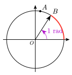

# ctz-trigo

*Draw the trigonometric unit circle with CeTZ, after ProfLycee's
`\CercleTrigo`. Documentation in French below.*

**Documentation : https://amjmeyer.github.io/ctz-trigo/**

Le cercle trigonométrique en Typst, d'après `\CercleTrigo` du paquet LaTeX
[ProfLycee](https://ctan.org/pkg/proflycee) de Cédric Pierquet, construit
avec [CeTZ](https://typst.app/universe/package/cetz).



```typ
#import "@preview/ctz-trigo:0.1.0": *

#trig-circle(
  radius: 2,
  remarkable: false,
  show-origin: true,
  tc-point(80deg, $A$),
  tc-ray(1rad, $B$, arrow: true),
  tc-arc(0, 1rad),
  tc-angle(0, 1rad, $1 "rad"$),
)
```

## Fonctions

- `trig-circle(..clés, ..éléments)` : le cercle, dans son propre canvas ;
  `trig-circle-draw(…)` : les mêmes éléments CeTZ, pour son propre canvas.
- Éléments à ajouter au cercle :
  - `tc-point(angle, nom)` : un point du cercle (marques au choix) ;
  - `tc-ray(angle, nom)` : un rayon ou un vecteur depuis O ;
  - `tc-vector(angle, nom, from: …)` : un vecteur n'importe où ;
  - `tc-arc(de, à, nom)` : un arc du cercle ;
  - `tc-angle(de, à, nom)` : un angle au centre ;
  - `tc-wind(x, nom)` : l'enroulement du réel x sur le cercle ;
  - `tc-interval(de, à)` : un segment de la droite réelle ;
  - `tc-cos-eq(α)`, `tc-sin-eq(α)` : les solutions de cos x = cos α, sin x = sin α ;
  - `tc-cos-sin(θ, nom)` : le point M(cos θ ; sin θ) et ses projections.

Toutes les clés sont décrites dans la documentation.

## Licence

MIT, voir [LICENSE](LICENSE).
